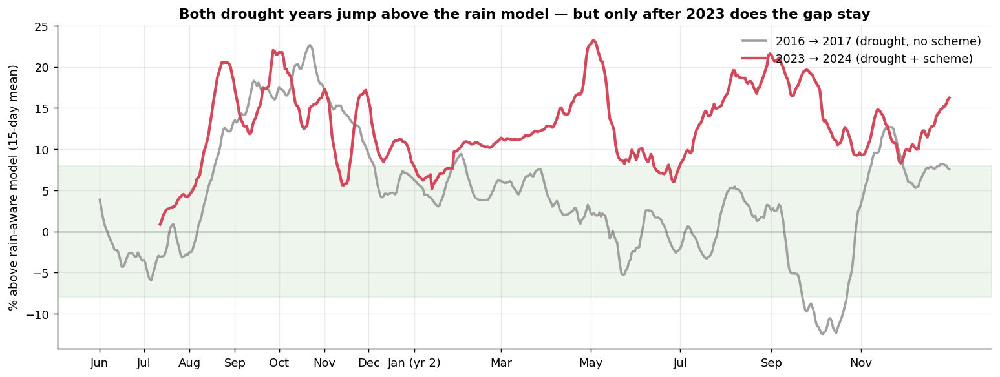
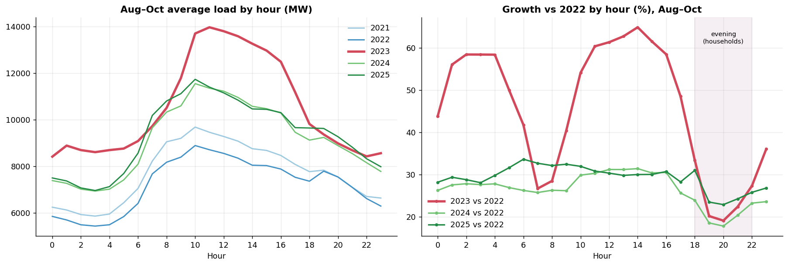

# ⚡ Free Power or Failed Monsoon?

**What really caused Karnataka's 2023 electricity surge — evidence from 15 years of hourly grid data**

In August 2023, Karnataka's electricity demand jumped by ~50% compared with August 2022. The same month, the state launched **Gruha Jyothi**
(free electricity for households) — and the **monsoon failed**. Was the surge caused by free power or by the drought?

## The answer

**Both were large, and the data cannot say which was larger.** The failed monsoon explains roughly **24–78%** of the
surge. The rest came from a lasting increase that began in August 2023 (free electricity plus other growth), which the
data cannot cleanly split.

Of the ~1,860 MW of extra demand in Aug–Oct 2023 (demand above what calendar, heat and normal growth predict,
i.e. +21.5% above the "Model A" baseline):

| Cause | Share |
|---|---|
| 🌧️ Failed monsoon (farm pumping during the drought) | **~24–78%** |
| 💡❓ Free electricity + other lasting changes | **~22–76%** |

Two natural experiments bracket the answer, loosely:
- **2016** (drought, no scheme; Aug–Oct farm-belt rain −46% vs normal, almost the same as 2023's −45%): demand rose
  +16.7% above expected, against 2023's +21.5%. So a drought alone can explain up to **~78%**.
- **2024** (scheme, wet year): after removing the effect of the extra rain, demand was still **+16.4% above
  expected**, a lasting increase that was still there in 2025. If it was already fully present in Aug–Oct 2023, the
  drought explains only **~24%**.

**What is robust:** a drought alone (2016) produced a jump nearly as large as 2023's, *and* a lasting +14–17%
increase beyond what weather explains started in August 2023 and has not gone away, in every model version tested.

> **Which baseline?** "+50%" = vs the same months of 2022. "+21.5%" and "1,860 MW" = vs Model A (a model that ignores
> rainfall). "+15.6%" = vs Model B (a model that includes rainfall). See the report.



## Key findings

1. **Demand tracked the rain** — it rose in dry spells and fell in rainy ones, both *before* and *after* the scheme
   started. The extra demand built up during two dry weeks in mid-August, not on the scheme's start date.
2. **The surge was in farm-pump hours** (day +60%, night +54% vs 2022), while evening household demand rose the same
   as in later years when rain was normal (+24% vs +21–26%).
3. **A drought year without the scheme (2016) looked almost the same** (+16.7% vs +21.5% above expected).
4. **A lasting increase switched on in August 2023 and stayed** — absent in 13–31 July 2023 (the first hourly data
   after a gap from January), present every month after,
   including evening household hours (+10–13% above expected in 2023–25). This fits a free-electricity effect, but the
   grid data cannot separate it from other growth. After the 2016 drought, by contrast, demand returned to normal.

**Context — 15 years of change:** peak demand grew 2.35× (7.8 → 18.4 GW), and the daily peak moved from 8 pm to
10 am as farm pumping shifted to daytime solar hours.



📄 **Full report:** [reports/final_report.md](reports/final_report.md)

## How it was done

1. **Data:** KPTCL hourly grid load 2011–2026 (135,000+ hours), generation and reservoir data; ERA5 weather for
   7 farm-belt towns and Bengaluru; Karnataka public holidays.
2. **Validation:** duplicates resolved, impossible values removed, every change logged; hourly data cross-checked
   against independent daily totals (correlation 0.9995).
3. **Counterfactual models:** trend × LightGBM trained **only on 2015–2022** to predict "normal" demand from
   calendar, temperature and rainfall; backtested on unseen years (typical monthly error ±7.6% for Model A, which
   ignores rain, and ±4% for Model B, which includes it).
4. **Separating causes:** rain regressions, hour-of-day fingerprints, change-point timing, weekday vs Sunday,
   external household data.
5. **Robustness:** faster-growth scenarios, placebo years, excluding doubtful days, re-fitting without the `year`
   feature, and two natural experiments (2016 and 2024) that bracket the drought share.

Methods follow Cicala (2020, *A View from the Grid*), Brodersen et al. (2015, *CausalImpact*) and Card & Krueger's
natural-experiment logic. Hypotheses and tests were written down at the start, before the models were built, in
[`00_analysis_plan.md`](00_analysis_plan.md). The repo was first committed after the analysis was finished, so Git
history cannot prove this order; the plan's change log records every later revision.

## Repo structure

```
00_analysis_plan.md   hypotheses & tests, written before the models were built (with change log)
notebooks/            01–02 Validate · 03–04 Describe · 05–07 Evaluate
src/                  data.py · clean.py · features.py · model.py · plots.py · config.py
reports/              final_report.md · validation_log.csv · figures/
data/                 raw → processed (not in Git; recreated by notebook 01)
```

## How to reproduce

```bash
pip install -r requirements.txt
cd notebooks
python -m jupyter nbconvert --to notebook --execute --inplace 01_data_collection.ipynb
# then 02 … 07 in order (07 takes several minutes)
```

## Limitations

The range is wide, and **the split depends on modelling choices**: re-fitting without the `year` feature moves the
brackets by 10+ points, although the lasting increase does not change. Grid load measures power that was *supplied*,
not true demand: in Oct 2023 farm supply was rationed (farmers reported 1–2 hours against a promised 7), so real
drought demand was likely higher than measured. The 2016 model is trained on 2011–2015, years of power shortage, and
has no backtest of its own. Each bound rests on one comparison year (2016, 2024), hourly data is missing for Jan–Jul
2023, the scheme cannot be separated from other lasting growth, and the hour-of-day mapping (households vs farms) is
approximate. See the [report](reports/final_report.md#6-limitations).

**Revision history:** the headline went from "~75% drought" to "43–78%" to "24–78%" after four external reviews.
The main fix: the 2024 comparison had counted 2024's wet weather as part of the 2023 drought. All shares are now
percentages of the same baseline (Model A's expected demand).
Details are in the analysis plan's change log.

## Data sources & credits

- Grid data: KPTCL daily load-curve reports, parsed by [Vonter/kptcl-load-curve](https://github.com/Vonter/kptcl-load-curve) (ODbL)
- Weather: [Open-Meteo](https://open-meteo.com/) historical archive (ERA5, CC BY 4.0)
- Holidays: [`holidays`](https://pypi.org/project/holidays/) Python package
- Context: Karnataka Economic Survey, Deccan Herald, IEA, Down To Earth (see report)
