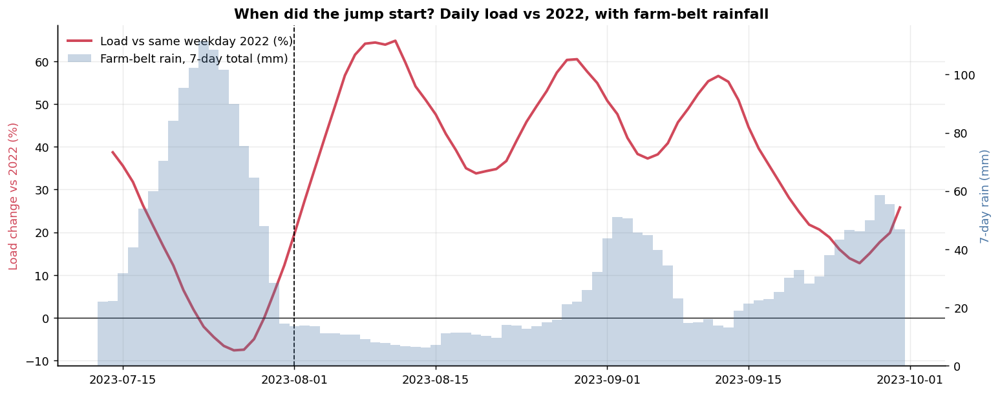
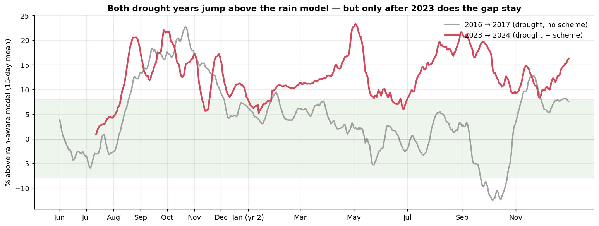
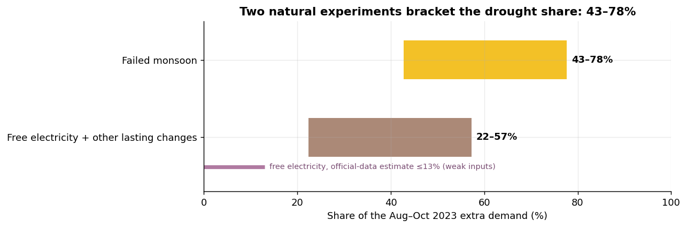

# Free Power or Failed Monsoon?
### What caused Karnataka's 2023 electricity surge — evidence from 15 years of hourly grid data

---

## ▲ The answer

**The failed monsoon was the largest identifiable driver of the 2023 surge — roughly 40–75% of it. The rest came
from a lasting increase that began in August 2023 (free electricity plus other growth), which the data cannot
cleanly split.**

Of the ~1,860 MW of extra demand in August–October 2023:

| Cause | Share | How it is bounded |
|---|---|---|
| 🌧️ **Failed monsoon** (farm pumping during the drought) | **~43–78%** | two natural experiments: 2016 and 2024 |
| 💡❓ **Free electricity + other lasting changes** | **~22–57%** | the remainder |
| *of which free electricity (official-data estimate)* | *≤13%* | *news figures and an old household share — reference only* |

Two natural experiments bracket the answer:
- **2016 — drought, no scheme:** demand rose +16.7% above expected (2023: +21.5%), so a drought alone can explain up
  to ~78% → **upper end**.
- **2024 — scheme, normal rain:** demand was *still* +12.3% above expected. If that lasting increase was already
  present in 2023, the drought explains only ~43% → **lower end**.

The lasting increase switched on around August 2023 and never went away; it includes a +10–13% rise in evening
household hours that fits a free-electricity effect. After the 2016 drought, by contrast, demand returned to normal.

> **Two measures are used in this report.** *Excess over Model A* = demand above what calendar, heat and growth
> predict (it includes the drought); for Aug–Oct 2023 it is **+21.5%**. *Excess over Model B* = demand above a model
> that also accounts for rainfall; for Aug–Oct 2023 it is **+15.6%**.

---

## 1. Situation — a grid that doubled and moved to daytime

Between 2011 and 2025, Karnataka's grid changed fundamentally:

- **Peak demand grew 2.35×** — from 7,815 MW to 18,395 MW (average demand 1.83×).
- **The daily peak moved from evening to morning.** In 2011–15 the peak came in the evening (5–10 pm) on 58% of
  days; in 2021–26 it came in the morning/midday on **96%** of days.
- **Growth happened in daylight.** From 2016 to 2025, daytime load grew **66%**, night and evening only 21–24% —
  consistent with farm pumping being moved to daytime solar hours.
- **Solar rose, coal fell, then coal returned.** Coal's share dropped from 49% (2015) to 17% (2020), then climbed back
  to ~26–30% as demand outgrew new solar.
- **Shortages almost disappeared.** Hours with grid frequency below 49.9 Hz fell from 72% (2011) to ~2%.

## 2. Complication — August 2023

Two things happened at the same time:

- **1 Aug 2023:** Gruha Jyothi began — free electricity up to 200 units/month for households.
- **The monsoon failed.** Farm-belt rain in Aug–Oct 2023 was **256 mm**, less than half of 2022 (578 mm) or 2024
  (589 mm). Karnataka's largest hydro reservoir (Linganamakki) was **42% full on 1 Nov** — the lowest in the data.

Demand exploded: **+49% in August and +56% in October** compared with the same months of 2022. Hydro power fell, so
**coal generation doubled** and the state bought far more power from outside.

The public debate was split: the government named the drought (and the scheme); critics blamed the scheme. No one
had measured how much each contributed.

## 3. Question

**How much of the 2023 surge was caused by the failed monsoon, and how much by free electricity?**

---

## 4. Key findings

### 4.1 Demand rose and fell with the rain — before and after the scheme started

- In a dry spell in mid-July 2023 — **before the scheme existed** — demand was already ~35–39% above 2022.
- Heavy rain in late July pushed it **below** 2022 just before 1 August.
- After 1 August, every rainy spell pulled demand down and every dry spell pushed it up. The scheme was the same every
  day, so it cannot produce these swings; rain can.
- The extra demand **built up over ~2 weeks of dry weather in mid-August** (best change point: 14 Aug) — not as a
  sudden jump on 1 Aug, as a policy switch-on would.

### 4.2 The extra demand appeared in farm-pumping hours, not household hours

Growth in Aug–Oct compared with 2022:

| Hours | 2023 (drought + scheme) | 2024 (normal rain + scheme) | 2025 |
|---|---|---|---|
| Night 0–5h (farm pumps) | **+54%** | +27% | +29% |
| Day 10–16h (farm pumps) | **+60%** | +31% | +31% |
| Evening 18–22h (households) | +24% | +21% | +26% |

The *extra* 2023 surge was in the hours when farm pumps run. The evening increase was similar in 2023, 2024 and 2025 —
but it is itself well above normal growth, which points to a lasting household-hour effect (see 4.4), not to the
absence of one.

### 4.3 Two natural experiments bracket the drought share

Using the same method (excess over Model A, Aug–Oct):

| Year | Situation | Demand above expected |
|---|---|---|
| 2016 | drought, **no scheme** | **+16.7%** |
| 2017 | normal rain, no scheme | −2.4% |
| 2023 | drought + scheme | **+21.5%** |
| 2024 | normal rain + scheme | **+12.3%** |
| 2025 | normal rain + scheme | +14.4% |

- **2016** shows what a drought *alone* does. During August–December, the 2016 and 2023 curves move almost
  together → the drought could explain up to **~78%** of 2023's excess.
- **2024** shows what the lasting increase does *without* a drought. If it was already present in Aug–Oct 2023,
  the drought explains only **~43%**. (Using 2025 instead gives ~33%, but 2025 includes another year of extra growth.)

### 4.4 A lasting increase switched on in August 2023 — and it includes household hours

- The excess over Model B was **+3.3% in July 2023** (normal), then **+7% to +17% in every month** from August 2023
  to June 2024, including months with no drought.
- **Evening household hours** were +10% to +13% above expected in 2023, 2024 and 2025, compared with −12% to +7% in
  pre-scheme test years. This **fits a free-electricity effect**, although faster general growth could also
  contribute.
- After the 2016 drought, demand returned to normal in 2017. After 2023 it did not.

**How large is the free-electricity part?** The grid data cannot separate it from other lasting growth. Official
figures (household use +7–11% in the first year; households ~20–25% of consumption) suggest **≤ ~240 MW (≤13%)**, but
these inputs are weak — news reports and a 2016-17 household share — so this is a reference estimate, not a firm
limit.

---

## 5. How sure are we?

The findings were tested by trying to break them:

| Test | Would break the finding if… | Result | Verdict |
|---|---|---|---|
| Faster growth trend (4–8%/yr instead of 3%) | the unexplained excess disappears | 816–1,276 MW remain | ✅ holds |
| Placebo years (2015, 2021, 2022) | the method finds fake effects | ≤ ±4.5% excess over Model B (2023: +15.6%) | ✅ holds |
| Drop 8 days where data sources disagree | results change | no change | ✅ holds |
| 2016 drought, no scheme | a drought alone gives the same jump | it does (+16.7% vs +21.5%) | sets the **upper end** (~78%) |
| 2024 scheme, normal rain | the lasting increase was already there in 2023 | +12.3% remains | sets the **lower end** (~43%) |

**On data trustworthiness:** rainfall and temperature come from ERA5 (European Centre for Medium-Range Weather
Forecasts) via Open-Meteo, not from any Indian government source. The rain–demand relationship appears in years
before the scheme (2016, 2019–2022). The hourly grid data agrees with KPTCL's separately reported daily energy totals
(correlation 0.9995). The drought range uses grid and weather data only; only the "≤13%" free-electricity estimate
relies on government household figures.

**Revision note:** an earlier version of this report gave a single best estimate of ~75% for the drought. After an
external review, the 2024 comparison was added as a lower bound, and the result is now reported as a range.

## 6. Limitations

- **Wide range.** The robust result is that the failed monsoon was the largest identifiable driver — not a precise
  split.
- **Each bracket rests on one year.** 2016 is older, less reliable data with a different farm supply schedule; 2024
  includes a year of extra growth and the drought's after-effects (low groundwater, a hot summer).
- **The scheme cannot be separated from other lasting growth** with grid data alone.
- **Missing data:** no hourly data from 3 Jan to 12 Jul 2023.
- **Hour-of-day mapping is approximate:** households also use power at night and in the day; some pumps run in the
  evening.
- **What the lasting increase consists of is open.** Candidates: the scheme (possibly larger than official figures
  suggest), faster growth after 2022, new farm connections or longer supply hours, Bengaluru's commercial growth
  (2024–25 shows a Sunday dip, unlike 2023).
- **Correlation-based reasoning:** natural experiments and counterfactual models support, but do not prove, causation.

## 7. Methodology

1. **Data** — KPTCL hourly grid load, generation, reservoirs (2011–2026, via Vonter/kptcl-load-curve); ERA5 weather
   via Open-Meteo for 7 farm-belt towns and Bengaluru; Karnataka public holidays.
2. **Validation** — resolved 5,344 duplicate hours, removed 6 impossible values, flagged 80 days that disagree with
   daily totals, kept gaps as missing (`reports/validation_log.csv`).
3. **Counterfactual models** (Cicala 2020; Brodersen et al. 2015) — trend × LightGBM, trained only on 2015–2022:
   Model A (calendar, holidays, temperature, growth trend) and Model B (+ rain anomalies). Backtested on unseen years:
   Model B's typical monthly error ±4%. Pre-scheme check (13–31 Jul 2023): +3.3%, within error.
4. **Separating causes** — rain regression within Aug–Dec 2023 (scheme constant), hour-of-day fingerprints,
   weekday/Sunday comparison, change-point search, external household data.
5. **Robustness** — trend sensitivity, placebo years, flagged-day exclusion, and two natural experiments
   (2016: drought without scheme; 2024: scheme without drought) that bracket the drought share.

The analysis plan, including hypotheses and the tests that would prove them wrong, was written before the analysis
(`00_analysis_plan.md`); every later change is logged there.

## Appendix

| Notebook | Stage | Content |
|---|---|---|
| `01_data_collection` | Validation | downloads, coverage check |
| `02_data_validation` | Validation | cleaning, cross-check, validation log |
| `03_fifteen_year_story` | Description | growth, daily shape, generation mix, reliability |
| `04_the_2023_shock` | Description | size, timing, hourly pattern, weather, supply |
| `05_counterfactual_model` | Evaluation | Models A and B, backtests, decomposition |
| `06_separating_causes` | Evaluation | rain regression, fingerprints, external limits |
| `07_robustness_checks` | Evaluation | trend, placebo, flagged days, 2016 |

**Sources:** KPTCL load curve reports (via [Vonter/kptcl-load-curve](https://github.com/Vonter/kptcl-load-curve), ODbL);
[Open-Meteo](https://open-meteo.com/) (ERA5); Karnataka Economic Survey 2017-18 (category shares, via ThePrint);
Deccan Herald, Varthabharati and Mangalore Today (household consumption, Aug 2023–Jul 2024); IEA and Down To Earth
(farm load shifted to daytime); Cicala (2020), Brodersen et al. (2015), Hunt & Bloomfield (2025).
