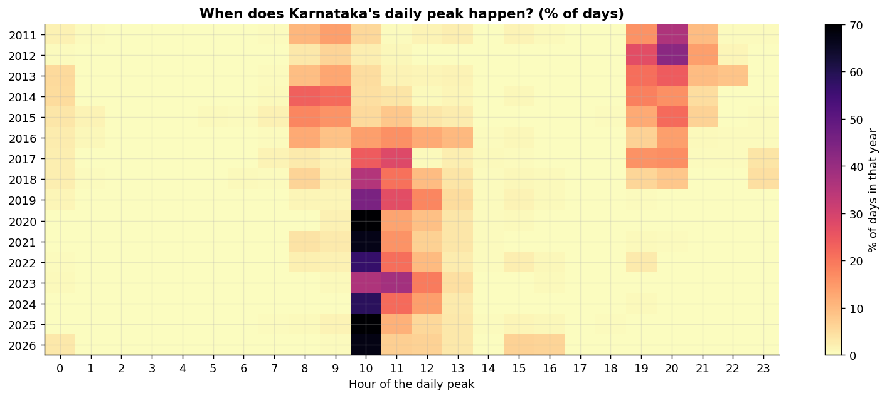
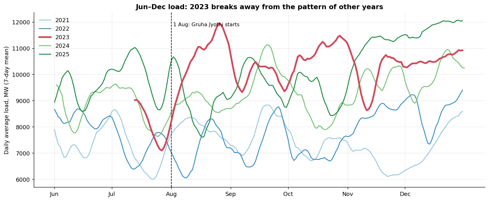
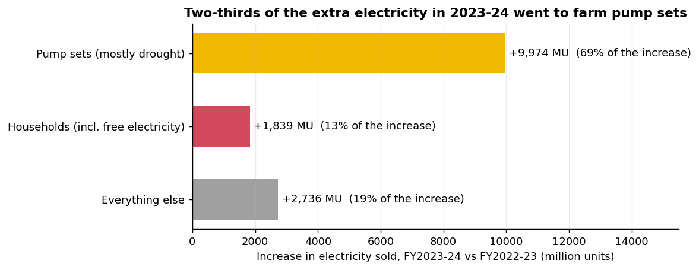
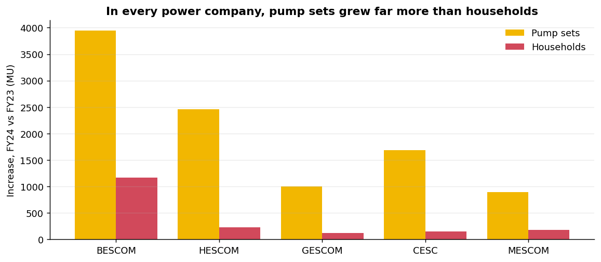

# Free Power or Failed Monsoon?
### What caused Karnataka's 2023 electricity surge — evidence from 15 years of hourly grid data and official electricity sales

---

## ▲ The answer

**Free electricity was a small part (at most 13% of the increase). Most of the extra electricity went to farm pump
sets, which the rain evidence ties mostly to the failed monsoon.**

Official electricity sales by customer type, FY2023-24 vs FY2022-23 (audited ESCOM filings; KERC Tariff Order 2025):

| Where the extra electricity went | Increase | Share of the increase |
|---|---|---|
| 🚜 **Irrigation pump sets** (mostly drought) | **+9,974 MU (+48%)** | **69%** |
| 🏠 **Households** (the only group that gets free electricity) | +1,839 MU (+13%) | 13% |
| 🏭 Everything else | +2,736 MU (+10%) | 19% |
| **Total** | **+14,549 MU (+23.5%)** | 100% |

- The pump-set increase was **5.4 times** the household increase, in all five power companies.
- After removing normal household growth (3–6%/yr), the scheme accounts for roughly **7–10%** of the increase.
- **Proven vs supported:** the household cap is direct (metered). That the pump-set growth was the drought is
  supported by the rain evidence in Sections 4.1–4.3, not proven by the sales table, which separates customer types,
  not causes. The 69% (share of the year-on-year increase) and the grid's 24–78% (share of demand above a model's
  expectation) measure different things.

The hourly grid data (Sections 4.1–4.4) points the same way but cannot rank the causes on its own, because it sees
only total demand. Of the ~1,860 MW of extra demand in August–October 2023 (demand above Model A's expectation, i.e.
+21.5%), grid data alone brackets the drought's share at **~24–78%**:
- **2016 — drought, no scheme:** demand rose +16.7% above expected (2023: +21.5%), so a drought alone can explain up
  to ~78% → **upper end**.
- **2024 — scheme, wet year:** after removing the effect of its extra rain, demand was still +16.4% above expected
  (+17.3% in 2025). If that lasting increase was already fully present in Aug–Oct 2023, the drought explains only
  ~24% → **lower end**.

Two findings are robust across every model version tested: a drought alone (2016) produced a jump nearly as large
as 2023's, and a **lasting +14–17% increase beyond what weather explains** switched on around August 2023 and never
went away. It includes a +10–13% rise in evening household hours that fits a free-electricity effect. After the 2016
drought, by contrast, demand returned to normal. The sales data (Section 4.5) shows that this lasting increase is
mostly **not households**: household sales grew +13% in FY2023-24, against +48% for pump sets.

> **Two measures are used in this report.** *Excess over Model A* = demand above what calendar, heat and growth
> predict (it includes the drought); for Aug–Oct 2023 it is **+21.5%**. *Excess over Model B* = demand above a model
> that also accounts for rainfall; for Aug–Oct 2023 it is **+15.6%** (+16.4% if expressed on Model A's baseline, as in §4.3). Separately, *growth vs 2022* (e.g. "+49% in
> August") compares with the same months a year earlier and includes normal growth, so it is always larger.

---

## 1. Situation — a grid that doubled and moved to daytime

Between 2011 and 2025, Karnataka's grid changed fundamentally:

- **Peak demand grew 2.35×** — from 7,815 MW to 18,395 MW (average demand 1.83×).
- **The daily peak moved from evening to morning.** In 2011–15 the peak came in the evening (5–10 pm) on 58% of
  days; in 2021–26 it came in the morning/midday on **96%** of days.
- **Growth happened in daylight.** From 2016 to 2025, daytime load grew **66%**, night and evening only 21–24% —
  consistent with farm pumping being moved to daytime solar hours.
- **Solar rose, coal fell, then coal returned.** Coal's share dropped from 49% (2015) to 17% (2020), then climbed back
  to ~26–30% as demand outgrew new solar.
- **Shortages almost disappeared.** Hours with grid frequency below 49.9 Hz fell from 72% (2011) to ~2%.

## 2. Complication — August 2023

Two things happened at the same time:

- **1 Aug 2023:** Gruha Jyothi began — free electricity up to 200 units/month for households.
- **The monsoon failed.** Farm-belt rain in Aug–Oct 2023 was **256 mm**, less than half of 2022 (578 mm) or 2024
  (589 mm). Karnataka's largest hydro reservoir (Linganamakki) was **42% full on 1 Nov** — the lowest in the data.

Demand exploded: **+49% in August and +56% in October** compared with the same months of 2022. Hydro power fell, so
**coal generation doubled** and the state bought far more power from outside.

The public debate was split: the government named the drought (and the scheme); critics blamed the scheme. No one
had measured how much each contributed.

## 3. Question

**How much of the 2023 surge was caused by the failed monsoon, and how much by free electricity?**

---

## 4. Key findings

### 4.1 Demand rose and fell with the rain — before and after the scheme started

- In a dry spell in mid-July 2023 — **before the scheme existed** — demand was already ~35–39% above 2022.
- Heavy rain in late July pushed it **below** 2022 just before 1 August.
- After 1 August, every rainy spell pulled demand down and every dry spell pushed it up. The scheme was the same every
  day, so it cannot produce these swings; rain can.
- The extra demand **built up over ~2 weeks of dry weather in mid-August** (best change point: 14 Aug) — not as a
  sudden jump on 1 Aug, as a policy switch-on would.

### 4.2 The extra demand appeared in farm-pumping hours, not household hours

Growth in Aug–Oct compared with 2022:

| Hours | 2023 (drought + scheme) | 2024 (normal rain + scheme) | 2025 |
|---|---|---|---|
| Night 0–5h (farm pumps) | **+54%** | +27% | +29% |
| Day 10–16h (farm pumps) | **+60%** | +31% | +31% |
| Evening 18–22h (households) | +24% | +21% | +26% |

The *extra* 2023 surge was in the hours when farm pumps run. The evening increase was similar in 2023, 2024 and 2025 —
but it is itself well above normal growth, which points to a lasting household-hour effect (see 4.4), not to the
absence of one.

### 4.3 Two natural experiments bracket the drought share

| Year | Situation | Excess over Model A (ignores rain) | Rain-adjusted excess (actual − Model B) |
|---|---|---|---|
| 2016 | drought, **no scheme** | **+16.7%** | +14.2% |
| 2017 | normal rain, no scheme | −2.4% | −2.6% |
| 2023 | drought + scheme | **+21.5%** | +16.4% |
| 2024 | wet + scheme | +12.3% | **+16.4%** |
| 2025 | wet + scheme | +14.4% | +17.3% |

Both columns are percentages of the **same baseline**, Model A's expected demand for that year. The 2016 and 2017
figures come from a model trained on 2011–2015; the others from the main model (2015–2022).

**Were the two droughts comparable?** Farm-belt rainfall (7 towns, ERA5) against the 2011–2022 average:

| | Jun–Oct | Aug–Oct |
|---|---|---|
| 2016 | 765 mm (−10%) | 250 mm (**−46%**) |
| 2023 | 596 mm (−30%) | 256 mm (**−45%**) |
| 2024 | 1,099 mm (+29%) | 589 mm (+26%) |

In the Aug–Oct window used here the two shortfalls are almost identical. 2023 was drier earlier in the season
(June–July), so groundwater and reservoirs were lower going in. This would make 2023's drought effect larger than
2016's and pushes the true drought share towards the upper end, not below it.

- **2016** shows what a drought *alone* does. During August–December, the 2016 and 2023 curves move almost
  together → the drought could explain up to **~78%** of 2023's excess.
- **2024** shows what the lasting increase does *without* a drought. 2024 was wet, and a model that ignores rain
  over-predicts in wet years, so the lasting increase must be measured rain-adjusted: actual minus Model B, which is
  1,333 MW. To compare like with like, it is expressed as a share of the same baseline as the 2023 figure, Model A's
  expected demand: **+16.4%**. If it was already fully present in Aug–Oct 2023, the drought explains only
  **(21.5 − 16.4) ÷ 21.5 ≈ 24%**. (Mixing baselines, i.e. using 2024's +17.1% over Model B, gives 21%; using raw MW,
  which mixes years with different grid sizes, gives 28%. Using 2025 instead of 2024 gives 20%.)

**Correction:** an earlier version used 2024's excess over Model A (+12.3%) and got a lower end of 43%. That figure
is the lasting increase *minus* the effect of 2024's extra rain, so it counted wet weather in 2024 as part of the
drought in 2023.

**The two ends do not fit together neatly.** If the full +17% lasting increase was present in Aug–Oct 2023, almost
nothing is left for the drought, yet 2016 shows a drought alone adds about as much. Both cannot fully hold. One
possible reason is that supply was rationed in October 2023 (see Limitations), which capped measured load, so the two
effects may not add up in the grid data. The truth is likely between the ends, but the data cannot say where.

### 4.4 A lasting increase switched on in August 2023 — and it includes household hours

- The excess over Model B was **+3.3% in 13–31 July 2023** (normal; hourly data resumes on 13 July after the
  January–July gap), then **+7% to +17% in every month** from August 2023
  to June 2024, including months with no drought.
- **Evening household hours** were +10% to +13% above expected in 2023, 2024 and 2025, compared with −12% to +7% in
  pre-scheme test years. This **fits a free-electricity effect**, although faster general growth could also
  contribute.
- After the 2016 drought, demand returned to normal in 2017. After 2023 it did not.

**How large is the free-electricity part?** The grid data cannot separate it from other lasting growth. Official
figures (household use +7–11% in the first year; households ~20–25% of consumption) suggest **≤ ~240 MW (≤13%)**, but
these inputs are weak — news reports and a 2016-17 household share — so this is a reference estimate, not a firm
limit.

### 4.5 Official sales by customer type: free electricity was a small part; two-thirds of the increase went to pump sets

Power companies report their annual sales to KERC **by tariff category**, which separates households (LT-1/LT-2a)
from irrigation pump sets (LT-4a). FY2022-23 actuals come from each company's audited Tariff Filing 2024; FY2023-24
actuals from KERC's Combined Tariff Order 2025 (Tables 4.3A–F). The five companies' FY24 figures add up exactly to
KERC's state totals, and the overall growth (+24.3%; +12.2% excluding pump sets) matches KERC's own statement that
FY24 sales rose "about 24%… mostly contributed by the increase in sales to IP sets… attributed to the drought".

| | FY2022-23 | FY2023-24 | Increase | Share of increase |
|---|---|---|---|---|
| 🚜 Pump sets | 20,596 MU | 30,570 MU | **+9,974 (+48%)** | **69%** |
| 🏠 Households | 14,531 MU | 16,370 MU | +1,839 (+13%) | 13% |
| 🏭 Everything else | 26,683 MU | 29,419 MU | +2,736 (+10%) | 19% |
| **Total (LT + HT)** | 61,811 MU | 76,360 MU | +14,549 (+23.5%) | 100% |

| Company | Pump-set increase | Household increase | Ratio |
|---|---|---|---|
| BESCOM (Bengaluru) | +3,943 MU | +1,165 MU | 3.4× |
| HESCOM | +2,457 MU | +229 MU | 10.7× |
| CESC | +1,685 MU | +147 MU | 11.4× |
| GESCOM | +997 MU | +117 MU | 8.5× |
| MESCOM | +891 MU | +181 MU | 4.9× |

- Pump-set connections barely changed (BESCOM: +18,552, about 2%), so the jump is more use per pump, which is what a
  drought causes. BESCOM itself attributes it to "scarcity of rainfall" after a wet FY23.
- Household sales are metered. Even if their entire +13% were due to free electricity, it would be 13% of the
  increase; after normal growth of 3–6%/yr, it is **7–10%**. This confirms the ≤13% estimate in Section 4.4, which
  used news reports.

---

## 5. How sure are we?

The findings were tested by trying to break them:

| Test | Would break the finding if… | Result | Verdict |
|---|---|---|---|
| Faster growth trend (4–8%/yr instead of 3%) | the unexplained excess disappears | 816–1,276 MW remain | ✅ holds |
| Placebo years (2015, 2021, 2022) | the method finds fake effects | ≤ ±4.5% excess over Model B (2023: +15.6%) | ✅ holds |
| Drop 8 days where data sources disagree | results change | no change | ✅ holds |
| 2016 drought, no scheme | a drought alone gives the same jump | it does (+16.7% vs +21.5%) | sets the **upper end** (~78%) |
| 2024 scheme, wet year (rain-adjusted) | the lasting increase was already there in 2023 | +16.4% remains | sets the **lower end** (~24%) |
| Re-fit without the `year` feature | the result depends on model setup | excesses over Model A fall ~6 points; upper end rises to 88%; the rain-adjusted lower end can't be computed reliably, because that Model B gets the rain effect backwards (it gives 6%); lasting increase stays +14–16% | ⚠️ **the split is model-dependent** |
| Official sales by customer type (FY24 vs FY23) | households grew about as much as pump sets | pump sets +9,974 MU, households +1,839 MU, same pattern in all 5 companies | ✅ **free electricity ≤13%**; pump sets (mostly drought) the largest part |

**Why test `year`:** trees cannot extrapolate it, so every 2023+ prediction uses the "2022" setting. Model A does not
see rain and may carry wet 2022's lower demand forward. Without `year`, Model A's backtest error improves (±6.1% vs
±7.6%), but Model B then predicts *less* demand in the 2023 drought than without rain, a wrong-sign result, so the
main models keep `year`. What survives both versions: the 2016 drought effect and the lasting increase.

**On data trustworthiness:** rainfall and temperature come from ERA5 (European Centre for Medium-Range Weather
Forecasts) via Open-Meteo, not from any Indian government source. ERA5 is the standard weather input in
electricity-demand research (e.g. Hunt & Bloomfield 2025), though local point rainfall can differ. The rain–demand relationship appears in years
before the scheme (2016, 2019–2022). The hourly grid data agrees with KPTCL's separately reported daily energy totals
(correlation 0.9995). The drought range uses grid and weather data only; only the "≤13%" free-electricity estimate
relies on news reports of government household figures. The sales comparison (Section 4.5) uses the regulator's
and the power companies' official, audited figures; pump-set sales within them are estimated rather than metered.

**Revision note:** the final answer comes from official sales by customer type (Section 4.5), added after four
reviews of the grid analysis. Grid-only history: the first version gave a single best estimate of ~75% for the drought. After a first external
review, 2024 was added as a lower bound (43–78%). A third review found that the 2024 bound counted 2024's wet weather
as drought (21–78%), and the headline no longer claims the drought was the largest driver. A fourth review noted
that 21% mixed two baselines; with every share on Model A's expected demand the range is 24–78%.

## 6. Limitations

- **Pump-set sales are estimated, not metered.** Most pump sets under 10 HP have no meter; ESCOMs estimate their use
  from feeder readings, and objectors argue some line losses are booked as pump use. The pump figure may be
  overstated. Household sales are metered, so the small household share holds either way.
- **Sales data is annual** (April–March). FY2023-24 includes four months before the scheme, and the Aug–Oct 2023 peak
  cannot be isolated. FY2022-23 was a wet year with low pump use. FY2024-25 actuals are not yet published.
- **Hand transcription** of FY23 figures from scanned filings (BESCOM, HESCOM, GESCOM); the FY24 sums and the overall
  growth match KERC's own figures, which makes large errors unlikely.
- **The sales data separates customer types, not causes.** The lasting increase in the grid data (~1,300–1,400 MW,
  still there in normal-rain 2024) is far larger than the household increase (~209 MW on average in FY24), so most of
  it is pump sets or other customers. If pump use stayed high after the rain returned, part of the FY24 pump growth is
  not drought. FY2024-25 sales will settle this.
- **Subsidy incentive:** ESCOMs are reimbursed by the state for pump-set power, which gives them a reason to book more
  energy (including losses) under pump sets.
- **Grid data alone gives a wide range** (24–78%) and cannot rank the causes; that is why the sales data was added.
- **Model-dependent split.** Dropping the `year` feature moves the brackets by 10+ points. Model A's typical monthly
  error on unseen years is ±7.6% (Model B: ±4%), and the brackets use Model A, so each end is uncertain by several
  points.
- **The upper end relies on a model trained on shortage years.** The 2016 model is trained on 2011–2015, when grid
  frequency was below 49.9 Hz in 31–77% of hours in 2011–2013 (≈2% in 2016), and it has no backtest of its own.
  Suppressed demand in training could make the 2016 excess, and so the ~78%, too high. 2017's result (−2.4%) is
  partly reassuring.
- **Load is supplied power, not true demand.** KPTCL data records electricity actually delivered. In October 2023
  farm supply was rationed: farmers reported 1–2 hours a day against a promised 7, protests followed, and HESCOM
  later planned 5–6 hours of three-phase supply in northern districts (Deccan Herald, 14 and 26 Oct 2023). Real
  drought-driven demand was therefore likely *higher* than measured, and changes in rationing hours can look like
  changes in demand. Rationing schedules in 2016 also differed. This mainly affects the drought estimate, probably
  making it too low.
- **Percentages assume a similar farm share.** Comparing 2016 and 2023 in percent assumes farm pumping was a similar
  share of total load in both years; if it was a larger or smaller slice in 2016, the same drought would produce a
  different percentage, and the ~78% upper end would move.
- **Each bracket rests on one year.** 2016 is older, less reliable data with a different farm supply schedule; 2024
  includes a year of extra growth and the drought's after-effects (low groundwater, a hot summer).
- **The scheme cannot be separated from other lasting growth** with grid data alone.
- **Missing data:** no hourly data from 3 Jan to 12 Jul 2023.
- **Hour-of-day mapping is approximate:** households also use power at night and in the day; some pumps run in the
  evening.
- **What the lasting increase consists of is open.** Candidates: the scheme (possibly larger than official figures
  suggest), faster growth after 2022, new farm connections or longer supply hours, Bengaluru's commercial growth
  (2024–25 shows a Sunday dip, unlike 2023).
- **Correlation-based reasoning:** natural experiments and counterfactual models support, but do not prove, causation.

## 7. Methodology

1. **Data** — KPTCL hourly grid load, generation, reservoirs (2011–2026, via Vonter/kptcl-load-curve); ERA5 weather
   via Open-Meteo for 7 farm-belt towns and Bengaluru; Karnataka public holidays.
2. **Validation** — resolved 5,344 duplicate hours, removed 6 impossible values, flagged 80 days that disagree with
   daily totals, kept gaps as missing (`reports/validation_log.csv`).
3. **Counterfactual models** (Cicala 2020; Brodersen et al. 2015) — trend × LightGBM, trained only on 2015–2022:
   Model A (calendar, holidays, temperature, growth trend) and Model B (+ rain anomalies). Backtested on unseen years:
   typical monthly error ±7.6% for Model A and ±4% for Model B. Pre-scheme check (13–31 Jul 2023): +3.3% over Model B,
   within error.
4. **Separating causes** — rain regression within Aug–Dec 2023 (scheme constant), hour-of-day fingerprints,
   weekday/Sunday comparison, change-point search, external household data.
5. **Robustness** — trend sensitivity, placebo years, flagged-day exclusion, re-fit without `year`, and two natural
   experiments (2016: drought without scheme; 2024: scheme without drought, rain-adjusted) that bracket the drought
   share.
6. **Sales by customer type** — FY23 and FY24 actual sales for households and pump sets from all five ESCOMs
   (audited filings and KERC Tariff Order 2025), transcribed with sources in `references/escom_sales_by_category.csv`
   and validated against KERC's state totals and stated growth.

The analysis plan, including hypotheses and the tests that would prove them wrong, was written at the start, before
the models were built (`00_analysis_plan.md`); every later change is logged there. The repository was first committed
after the analysis was complete, so Git history cannot prove this order.

## Appendix

| Notebook | Stage | Content |
|---|---|---|
| `01_data_collection` | Validation | downloads, coverage check |
| `02_data_validation` | Validation | cleaning, cross-check, validation log |
| `03_fifteen_year_story` | Description | growth, daily shape, generation mix, reliability |
| `04_the_2023_shock` | Description | size, timing, hourly pattern, weather, supply |
| `05_counterfactual_model` | Evaluation | Models A and B, backtests, decomposition |
| `06_separating_causes` | Evaluation | rain regression, fingerprints, external limits |
| `07_robustness_checks` | Evaluation | trend, placebo, flagged days, 2016 and 2024 brackets, `year` check |
| `08_sales_data_answer` | Evaluation | official sales by customer type, FY23 vs FY24, by company |

**Sources:** KPTCL load curve reports (via [Vonter/kptcl-load-curve](https://github.com/Vonter/kptcl-load-curve), ODbL);
[Open-Meteo](https://open-meteo.com/) (ERA5); Karnataka Economic Survey 2017-18 (category shares, via ThePrint);
KERC Combined Tariff Order 2025 and ESCOM Tariff Filings 2024 (sales by category, FY23–FY24); Deccan Herald,
Varthabharati and Mangalore Today (household consumption, Aug 2023–Jul 2024); Deccan Herald, Oct 2023 (farm supply rationing); IEA and Down To Earth
(farm load shifted to daytime); Cicala (2020), Brodersen et al. (2015), Hunt & Bloomfield (2025).
