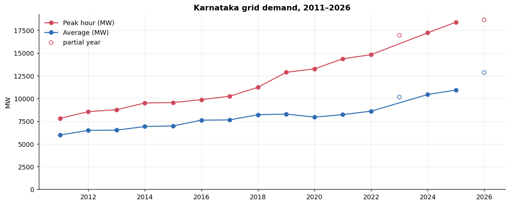
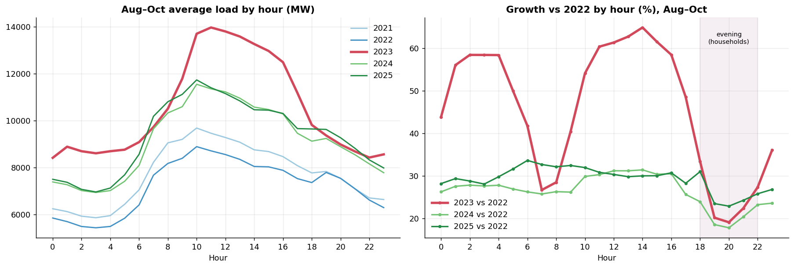

# Free Power or Failed Monsoon?
### What caused Karnataka's 2023 electricity surge — evidence from 15 years of hourly grid data

---

## ▲ The answer

**The 2023 surge was driven mainly by the failed monsoon, not by the free-electricity scheme.**

Of the ~1,860 MW of extra demand in August–October 2023:

| Cause | Best estimate | Plausible range |
|---|---|---|
| 🌧️ **Failed monsoon** (farm pumping during the drought) | **~75%** | 24–78% |
| 💡 **Free electricity** (Gruha Jyothi, households) | **≤13%** | 0–13% using official household data; ≤22% using grid data only |
| ❓ **Other** | ~10–20% | — |

The strongest evidence: **2016 had an equally failed monsoon and no free electricity, and its demand followed
almost the same path** (+16.7% above normal, vs +21.5% in 2023).

One thing neither cause explains: after the 2016 drought demand returned to normal, but **after 2023 it stayed
high through 2024 and 2025**.

---

## 1. Situation — a grid that doubled and moved to daytime

Between 2011 and 2025, Karnataka's grid changed fundamentally:

- **Peak demand grew 2.35×** — from 7,815 MW to 18,395 MW (average demand 1.83×).
- **The daily peak moved from evening to morning.** In 2011–15 the peak came in the evening (5–10 pm) on 58% of
  days; in 2021–26 it came in the morning/midday on **96%** of days.
- **Growth happened in daylight.** From 2016 to 2025, daytime load grew **66%**, night and evening only 21–24% —
  consistent with farm pumping being moved to daytime solar hours.
- **Solar rose, coal fell, then coal returned.** Coal's share dropped from 49% (2015) to 17% (2020), then climbed back
  to ~26–30% as demand outgrew new solar.
- **Shortages almost disappeared.** Hours with grid frequency below 49.9 Hz fell from 72% (2011) to ~2%.

## 2. Complication — August 2023

Two things happened at the same time:

- **1 Aug 2023:** Gruha Jyothi began — free electricity up to 200 units/month for households.
- **The monsoon failed.** Farm-belt rain in Aug–Oct 2023 was **256 mm**, less than half of 2022 (578 mm) or 2024
  (589 mm). Karnataka's largest hydro reservoir (Linganamakki) was **42% full on 1 Nov** — the lowest in the data.

Demand exploded: **+49% in August and +56% in October** compared with the same months of 2022. Hydro power fell, so
**coal generation doubled** and the state bought far more power from outside.

The public debate was split: the government named the drought (and the scheme); critics blamed the scheme. No one
had measured how much each contributed.

## 3. Question

**How much of the 2023 surge was caused by the failed monsoon, and how much by free electricity?**

---

## 4. Key findings

### 4.1 Demand rose and fell with the rain — before and after the scheme started

- In a dry spell in mid-July 2023 — **before the scheme existed** — demand was already ~35–39% above 2022.
- Heavy rain in late July pushed it **below** 2022 just before 1 August.
- After 1 August, every rainy spell pulled demand down and every dry spell pushed it up. The scheme was the same every
  day, so it cannot produce these swings; rain can.
- The extra demand **built up over ~2 weeks of dry weather in mid-August** (best change point: 14 Aug) — not as a
  sudden jump on 1 Aug, as a policy switch-on would.

### 4.2 The extra demand appeared in farm-pumping hours, not household hours

Growth in Aug–Oct compared with 2022:

| Hours | 2023 (drought + scheme) | 2024 (normal rain + scheme) | 2025 |
|---|---|---|---|
| Night 0–5h (farm pumps) | **+54%** | +27% | +29% |
| Day 10–16h (farm pumps) | **+60%** | +31% | +31% |
| Evening 18–22h (households) | +24% | +21% | +26% |

The evening increase in 2023 was the same as in 2024–25, when the scheme continued but rain was normal. The extra
2023 surge was in the hours when farm pumps run.

### 4.3 A drought year without free electricity looked almost the same

2016 had a monsoon as dry as 2023 (250 mm vs 256 mm) and no scheme. Using the same method:

| Year | Situation | Demand above expected (Aug–Oct) |
|---|---|---|
| 2016 | drought, **no scheme** | **+16.7%** |
| 2017 | normal rain, no scheme | −2.4% |
| 2023 | drought + scheme | **+21.5%** |
| 2024 | normal rain + scheme | +12.3% |

During August–December, the 2023 and 2016 curves move almost together. A drought alone produced most of a
2023-sized surge.

### 4.4 Free electricity can explain only a small share

Two independent limits:

- **Using official household figures:** household use rose 7–11% in the scheme's first year, and households are
  ~20–25% of consumption → **at most ~240 MW, ≤13%** of the 2023 excess.
- **Using grid data only** (no government household figures): the 2016 drought alone produced +16.7%; 2023 was +21.5%.
  Everything except the drought — including the scheme — can therefore explain at most ~5 points, **≤22%**.

---

## 5. How sure are we?

The findings were tested by trying to break them:

| Test | Would break the finding if… | Result | Verdict |
|---|---|---|---|
| Faster growth trend (4–8%/yr instead of 3%) | the unexplained excess disappears | 816–1,276 MW remain | ✅ holds |
| Placebo years (2015, 2021, 2022) | the method finds fake effects | ≤ ±4.5% (2023: +15.6%) | ✅ holds |
| Drop 8 days where data sources disagree | results change | no change | ✅ holds |
| 2016 drought, no scheme | a drought alone gives the same jump | it does (+16.7%) | ⚠️ raised the drought share from ~30% to ~75% |

**On data trustworthiness:** rainfall and temperature come from ERA5 (European Centre for Medium-Range Weather
Forecasts) via Open-Meteo, not from any Indian government source. The rain–demand relationship appears in years
before the scheme (2016, 2019–2022). The hourly grid data agrees with KPTCL's separately reported daily energy totals
(correlation 0.9995). Only the "≤13%" limit relies on government household figures; the grid-only limit (≤22%) does not.

## 6. Limitations

- **Wide ranges.** The robust result is the *ranking* (monsoon ≫ free electricity), not a precise split.
- **One comparison drought year.** 2016 is a strong analogue but not a perfect twin (older data, different farm supply
  schedule).
- **Missing data:** no hourly data from 3 Jan to 12 Jul 2023.
- **Hour-of-day mapping is approximate:** households also use power at night and in the day; some pumps run in the
  evening.
- **The lasting rise after 2023 is unexplained.** Demand stayed 10–20% above the model through 2024–25, unlike after
  2016. Candidates: the scheme (if larger than official figures), faster growth, new farm connections or longer supply
  hours, Bengaluru's commercial growth. This is a separate question from the 2023 shock.
- **Correlation-based reasoning:** natural experiments and counterfactual models support, but do not prove, causation.

## 7. Methodology

1. **Data** — KPTCL hourly grid load, generation, reservoirs (2011–2026, via Vonter/kptcl-load-curve); ERA5 weather
   via Open-Meteo for 7 farm-belt towns and Bengaluru; Karnataka public holidays.
2. **Validation** — resolved 5,344 duplicate hours, removed 6 impossible values, flagged 80 days that disagree with
   daily totals, kept gaps as missing (`reports/validation_log.csv`).
3. **Counterfactual models** (Cicala 2020; Brodersen et al. 2015) — trend × LightGBM, trained only on 2015–2022:
   Model A (calendar, holidays, temperature, growth trend) and Model B (+ rain anomalies). Backtested on unseen years:
   Model B's typical monthly error ±4%. Pre-scheme check (13–31 Jul 2023): +3.3%, within error.
4. **Separating causes** — rain regression within Aug–Dec 2023 (scheme constant), hour-of-day fingerprints,
   weekday/Sunday comparison, change-point search, external household data.
5. **Robustness** — trend sensitivity, placebo years, flagged-day exclusion, 2016 natural experiment.

The analysis plan, including hypotheses and the tests that would prove them wrong, was written before the analysis
(`00_analysis_plan.md`); every later change is logged there.

## Appendix

| Notebook | Stage | Content |
|---|---|---|
| `01_data_collection` | Validation | downloads, coverage check |
| `02_data_validation` | Validation | cleaning, cross-check, validation log |
| `03_fifteen_year_story` | Description | growth, daily shape, generation mix, reliability |
| `04_the_2023_shock` | Description | size, timing, hourly pattern, weather, supply |
| `05_counterfactual_model` | Evaluation | Models A and B, backtests, decomposition |
| `06_separating_causes` | Evaluation | rain regression, fingerprints, external limits |
| `07_robustness_checks` | Evaluation | trend, placebo, flagged days, 2016 |

**Sources:** KPTCL load curve reports (via [Vonter/kptcl-load-curve](https://github.com/Vonter/kptcl-load-curve), ODbL);
[Open-Meteo](https://open-meteo.com/) (ERA5); Karnataka Economic Survey 2017-18 (category shares, via ThePrint);
Deccan Herald, Varthabharati and Mangalore Today (household consumption, Aug 2023–Jul 2024); IEA and Down To Earth
(farm load shifted to daytime); Cicala (2020), Brodersen et al. (2015), Hunt & Bloomfield (2025).
